<div align="center">

# SolarTriage

**From thermal drone footage to maintenance decisions — and from PV forecasts to battery dispatch.**

Calibrated computer vision · expected-risk triage · constrained crew scheduling · market-aware battery dispatch

[](https://github.com/jiri133/S-WAGG/actions/workflows/ci.yml)


Built in 24 hours at **Smarthack XI** (PPC Renewables theme) · 5 contributors · ~270 commits

</div>

<p align="center">
  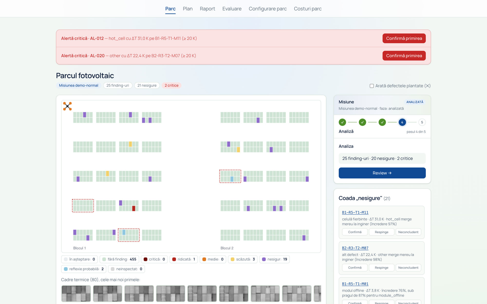
</p>

## The problem

A 480-module solar park produces hundreds of thermal anomalies per drone flight. An O&M
engineer has to decide what to repair, in what order, by whom and when — usually from
spreadsheets, with weeks of latency and inconsistent judgement.

SolarTriage closes that loop. It simulates the drone flight, rejects unusable frames,
classifies every module with a calibrated model, quantifies the expected energy loss, and
writes the work orders and the crew plan. A second module answers the next question for the
same park: given the PV forecast and OPCOM day-ahead prices, how should the battery be
dispatched?

The UI is in Romanian because the target user is a Romanian O&M engineer. The screenshots
below keep the real UI; captions translate the important labels.

## What it does

| Inspection triage | Battery dispatch |
|---|---|
| **Input:** seeded drone flight over a 480-module park (2 blocks × 5 rows × 4 tables × 12 modules), two passes per table. | **Input:** OPCOM PZU 15-minute prices, ENTSO-E load, Open-Meteo weather and irradiance, active farm config. |
| **Pipeline:** frame QA → GPS registration → 24×40 crop → ONNX ResNet18 ×2 → temperature scaling → selective thresholds → two-pass consistency. | **Pipeline:** aligned 15-minute dataset → gradient-boosted PV forecast → receding-horizon dispatch every 4 h. |
| **Decision:** expected-risk score, ΔT ≥ 20 K safety override, work orders, watch list, human review, greedy crew planner with skills/shifts/leave/weather/travel. | **Strategies:** LLM agent with tools, MPC/LP, price-threshold, rule-based, idle. Every decision is validated and auditable. |
| **Output:** prioritised findings, Grad-CAM + similar cases, work orders (JSON/CSV), alerts/webhook, multi-day plan, HTML report. | **Output:** settlement in RON, 8 KPI tiles, price/PV/SoC/power charts, decision log, 96-interval table. |

## Results at a glance

| Fault model (test) | Selective prediction | PV forecast (test) | Battery dispatch (validation) |
|---:|---:|---:|---:|
| **0.729** macro-F1 | **95.7%** precision on **64.5%** auto-passed crops | **0.097 MW** MAE | **+20.1%** vs idle |
| vs 0.374 rules · 0.541 Random Forest · 0.588 small CNN | the rest go to an engineer | **74%** below persistence | ties price threshold · **−3.3%** vs MPC |

All numbers come from committed artifacts: `reports/eval.json` and
`RL/artifacts/reports/{val,test}/results.csv`. They are reproducible with the commands at
the bottom of this page.

## Architecture

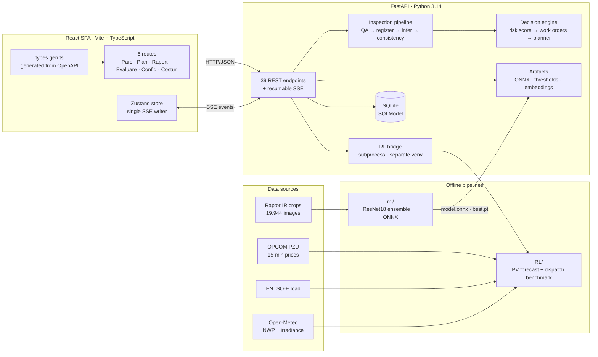

| Layer | Responsibility |
|---|---|
| **React SPA** | Six routes: mission cockpit, plan, report, evaluation, farm config, battery simulation. Zustand holds UI state; one SSE hook is the only writer; TypeScript types are generated from OpenAPI. |
| **FastAPI API** | 39 endpoints under `/api`, resumable SSE, SQLite persistence, static SPA serving in deploy mode. |
| **Inspection services** | Deterministic simulator, data QA, GPS registration, ONNX inference, calibration, consistency, decision rules, planner, Grad-CAM, similar cases, HTML report. |
| **ML offline** | Dataset preparation, ResNet18 training, TTA/class-bias selection, ONNX export, calibration, embedding index, baselines, test evaluation. |
| **Battery package** | Separate `battery-rl` package with its own venv: data adapters, PV model, battery physics, strategies, LLM agent, evaluation runner. |
| **Storage** | SQLite for durable decisions/results; in-memory live state for SSE and flight progress; artifacts on disk for the model, thresholds, embeddings and evaluation reports. |
| **Deploy & CI** | One container (FastAPI serves the built React app) for Railway/Hugging Face Spaces; four GitHub Actions jobs. |

**Boundaries that matter**

- Browser ↔ backend is HTTP/JSON + SSE only. React never runs inference or business rules.
- Pydantic → OpenAPI → `frontend/src/api/types.gen.ts`; the types are generated, never edited.
- The battery package is a separate process: the backend spawns `RL/.venv` Python and exchanges JSON. This avoids dependency conflicts (`pandas`/`SciPy`/OpenAI SDK vs the backend) and isolates crashes.
- SQLite keeps the decisions; the SSE replay and flight progress live in memory and are re-synchronised with `GET /api/missions/{id}` after a restart.

## How the inspection works

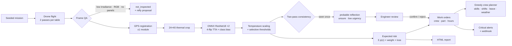

1. **A deterministic digital twin.** Frames are composed from real Raptor crops in the held-out
   test split. Everything is driven by a seed: cloud, glare, GPS offset, missing frames, RGB
   frames and frames without panels. The demo missions therefore reproduce exactly.
2. **Data QA before ML.** Irradiance below 600 W/m², wind above 8 m/s, RGB/non-radiometric
   frames, bare ground and missing metadata are rejected. A table without a valid frame becomes
   `not_inspected` — never “healthy” — and gets a re-fly proposal.
3. **GPS registration.** A ground column or table edge gives a ±1-module offset; the 12 module
   slots are re-aligned before inference.
4. **Inference and calibration.** Each 24×40 crop goes through one 89 MB ONNX graph containing
   the two-ResNet18 ensemble, in-graph preprocessing, four-flip TTA and per-class bias. Logits
   are divided by the fitted temperature before softmax.
5. **Selective prediction.** Per-class thresholds target 95% precision on auto-passed crops.
   Classes that cannot reach the target with enough support are always routed to an engineer.
   On test, 64.5% of crops pass automatically at 95.7% precision.
6. **Two-pass consistency.** An anomaly seen in only one of the two passes becomes “probable
   reflection”, `unsure`, low urgency. A defect appears in both passes.
7. **Expected-risk decision.** The score uses the full probability vector, not the argmax:

   ```text
   score(finding) = Σ_c p(c) × weight(urgency(c)) × loss_kWh_day(c)
   loss_kWh_day  = 0.55 kWp × fraction(c) × PVGIS daily yield
   safety        : ΔT ≥ 20 K → critical + alert, regardless of predicted class
   ```

   The urgency comes from the class with the largest contribution. Every finding gets a work
   order; a watch list withholds the order when `p(ok) ≥ 0.10` and the finding is not critical,
   until an engineer confirms it. Review is an override: confirm makes it a plain repair, reject
   removes the order, inconclusive asks for reinspection.
8. **Planning.** Critical findings go on day 1. The rest are sorted by score, grouped by table
   and row, and placed with a crew that has the right skill and part, in working hours, around
   shifts, days off, leave, rain/wind closures and travel time. Every task carries a written
   reason. Approving a plan freezes it and reserves its crew-hours against other missions.

## How the model was built

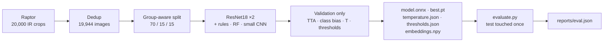

- **Dataset.** Raptor Maps `InfraredSolarModules` (MIT): 20,000 grayscale 24×40 IR crops,
  12 classes mapped to 8. Exact and near-duplicate removal (pixel RMS ≤ 3, group-aware) leaves
  **19,944**. Stratified group split, seed 42: **13,972 / 2,995 / 2,977**. The test split is
  used once.
- **Training.** Two ResNet18 members, ImageNet-pretrained, 30 epochs, AdamW + OneCycle,
  class-weighted loss plus oversampling, label smoothing, flip/brightness/noise/glare/blur
  augmentation. Validation selects the 4-flip TTA and per-class bias; the ensemble goes from
  0.719 to **0.744** macro-F1 on validation.
- **Serving.** One ONNX graph, opset 17, input `(batch, 1, 40, 24)` in `[0, 1]`. Resize,
  ImageNet normalisation, TTA and bias are inside the graph, so the backend only divides by 255.
- **Calibration.** Temperature scaling, `T = 0.761`; ECE **0.106 → 0.031**. Per-class
  thresholds then target precision on the auto-passed subset.
- **Explainability.** Grad-CAM on `layer3` (HiResCAM-style gradient × activation; `layer4` is
  too coarse at 64×96) and cosine top-3 similar training crops from a 512-d embedding index.

<p align="center">
  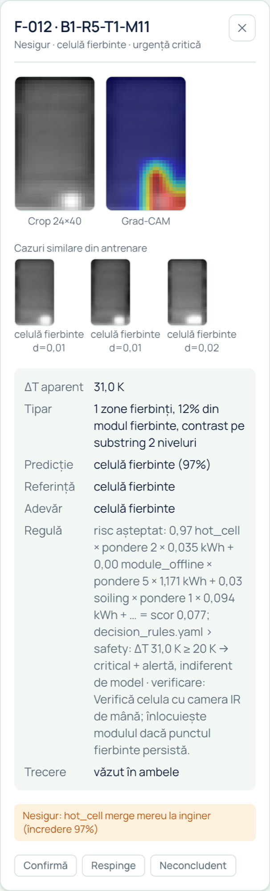
  <br>
  <em>One finding: the 24×40 crop, Grad-CAM, three similar training cases, apparent ΔT, the quoted decision rule and the engineer's review buttons.</em>
</p>

**Test results (n = 2,977):**

| Model | macro-F1 | accuracy |
|---|---:|---:|
| Rules on intensity features | 0.374 | 0.547 |
| Random Forest on the same features | 0.541 | 0.710 |
| Small CNN from scratch (ablation) | 0.588 | 0.719 |
| **ResNet18 ×2 ensemble** | **0.729** | **0.850** |

<details>
<summary>Degradation on the clean test set (macro-F1; clean = 0.729)</summary>

| Perturbation | Level 1 | Level 2 | Level 3 |
|---|---:|---:|---:|
| Gaussian noise σ = 5 / 10 / 20 | 0.719 | 0.618 | 0.293 |
| Blur radius 0.5 / 1 / 2 px | 0.722 | 0.686 | 0.483 |
| Contrast kept 75 / 50 / 25% | 0.694 | 0.548 | 0.262 |

</details>

## How the battery dispatch works

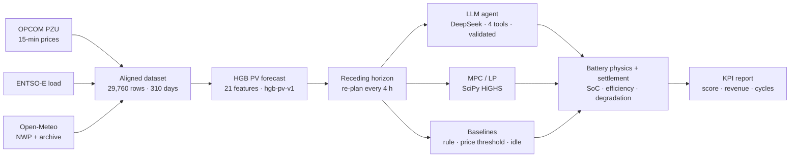

- **Data.** OPCOM PZU 15-minute prices, ENTSO-E national load, Open-Meteo archive irradiance as
  the PV-actual proxy, ECMWF IFS Single Runs NWP and aerosol. The aligned dataset has **29,760
  rows over 310 delivery days**. Chronological splits: train Jan–Jul, validation Aug–Sep, test
  Oct–Nov 6. Every target interval records the forecast issue time; a forecast issued after its
  target is rejected.
- **PV forecast.** `HistGradientBoostingRegressor` with 21 features (NWP, calendar, clear-sky
  index, lead time, PV lags, aerosol), 400 iterations, learning rate 0.05, 31 leaves, clipped
  to the inverter AC. Test: **MAE 0.0971 MW, RMSE 0.2230, bias 0.0358** — 74.4% below the
  persistence baseline (62.0% on validation).
- **Battery.** 10 MWh / 2 MW, SoC 10–90%, 95% charge and discharge efficiency, 50 RON/MWh
  degradation, 17 discrete action levels, 96 intervals per day, zero site demand (merchant
  export). The objective is `−cash − degradation − violation penalty + terminal value`.
- **Dispatch.** Every 4 hours the agent sees known prices, the rest-of-day PV forecast, national
  load, battery state, previous plan and grid limits. The DeepSeek agent can call
  `get_state`, `get_forecast`, `simulate_schedule` (deterministic replay, max 3 calls) and
  `submit_schedule`; its 16-action plan is validated for length, allowed levels and SoC
  feasibility, with one retry and a rule-based fallback. MPC solves the rest-of-day LP with
  SciPy HiGHS and quantises the solution to executable levels.

**Validation, block mode (3 repeats/day):**

| Strategy | Day score | Net cost (RON) | Cycles |
|---|---:|---:|---:|
| Idle | 30,421 | −26,341 | 0.000 |
| Rule-based | 30,803 | −24,187 | 0.326 |
| Price threshold | 36,383 | −36,410 | 0.897 |
| **LLM agent** | **36,525** | **−36,323** | **0.949** |
| MPC / oracle LP | 37,760 | −38,076 | 1.155 |

**The honest headline:** the LLM agent beats idle by **+20.1%**, rule-based by **+18.6%** and
ties the price threshold (**+0.4%**), but trails MPC by **−3.3%**. On test the gaps are
+16.1%, +15.7%, −0.4% and −3.7%. It produces 100% feasible schedules with no fallbacks, at
about **0.07 RON/day** of API cost. The gap is economic, not operational: it leaves roughly 18%
of the arbitrage volume unused.

Deeper detail on the data contract and the forecaster is in `RL/PV_MODEL.md`; package setup and
the strategy protocol are in `RL/README.md`.

## Screens

The UI is Romanian; the captions translate the important labels.

<table>
  <tr>
    <td width="50%"><br><em>Mission cockpit after a seeded flight: critical alerts, 480-module thermal map, review queue, agent journal and ticket inbox.</em></td>
    <td width="50%">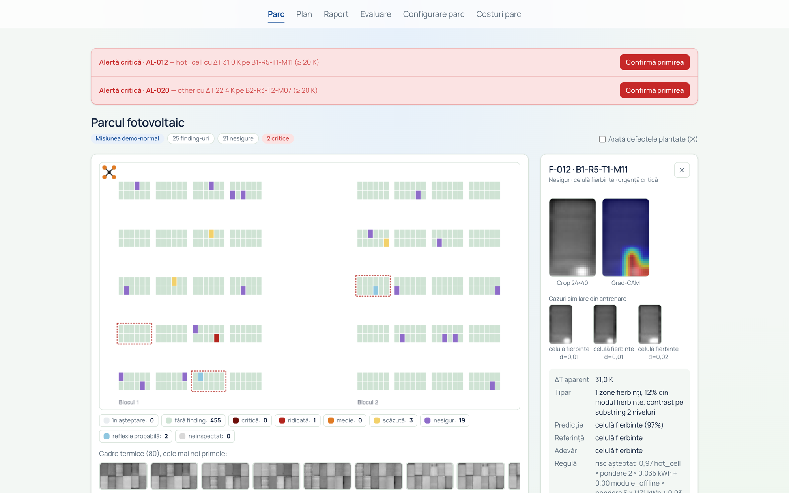<br><em>A finding selected in the cockpit: the map stays visible while the evidence card shows crop, Grad-CAM, similar cases and the applied rule.</em></td>
  </tr>
  <tr>
    <td>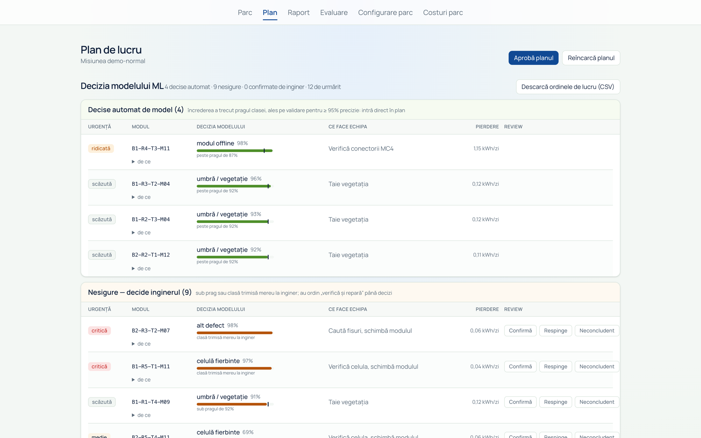<br><em>ML decisions split into automatic, unsure and watch-list groups, with confidence bars and class thresholds.</em></td>
    <td>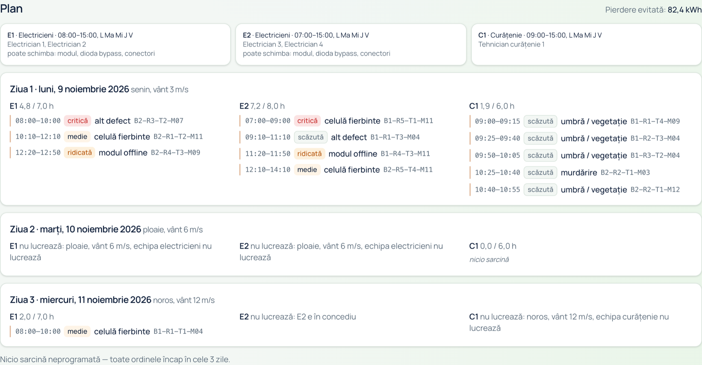<br><em>The crew plan: skills, shifts, travel, weather closures, leave and a written reason for every task.</em></td>
  </tr>
  <tr>
    <td>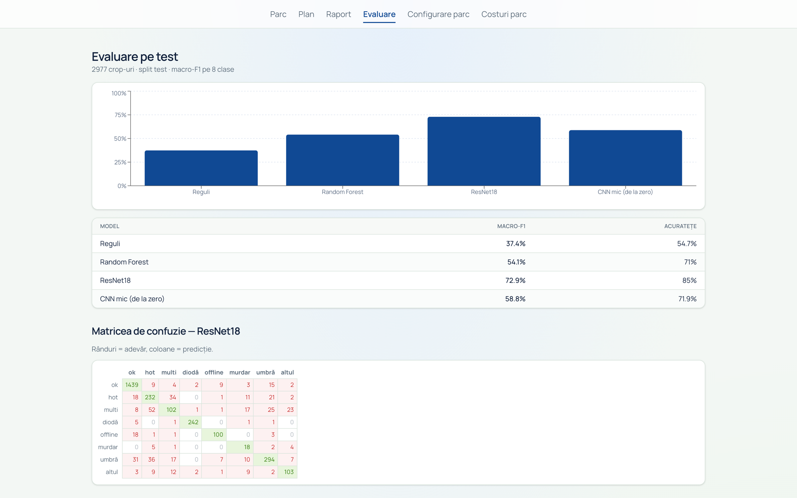<br><em>Model comparison, confusion matrix, calibration and degradation results from the committed <code>eval.json</code>.</em></td>
    <td>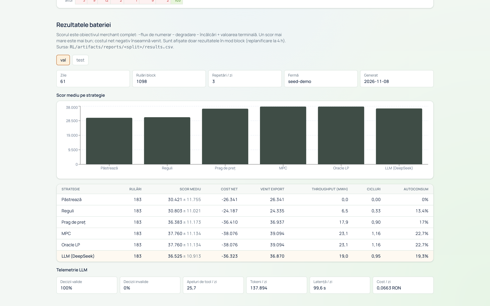<br><em>Battery strategy benchmark from <code>RL/artifacts/reports</code>, including LLM telemetry.</em></td>
  </tr>
  <tr>
    <td>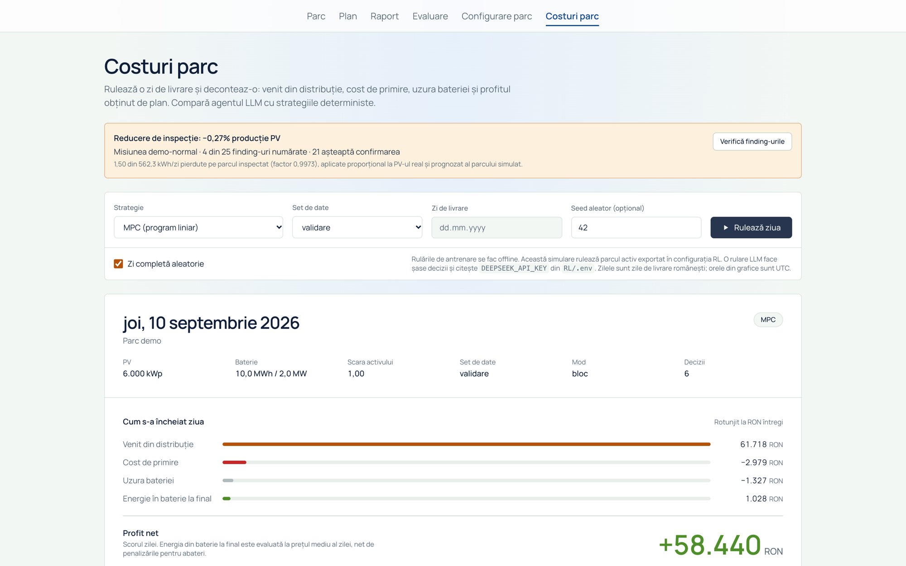<br><em>Battery day settlement: revenue, import cost, degradation, terminal energy and net profit.</em></td>
    <td>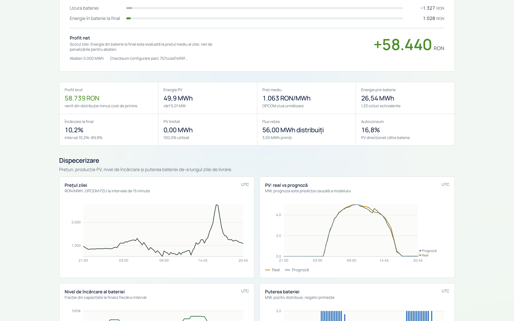<br><em>KPI tiles and the first dispatch charts: OPCOM day-ahead price and PV actual vs forecast. The SOC/power charts continue in the decision-log screen below.</em></td>
  </tr>
</table>

<details>
<summary>More screens: decision log, farm configuration, generated report</summary>

<table>
  <tr>
    <td width="50%">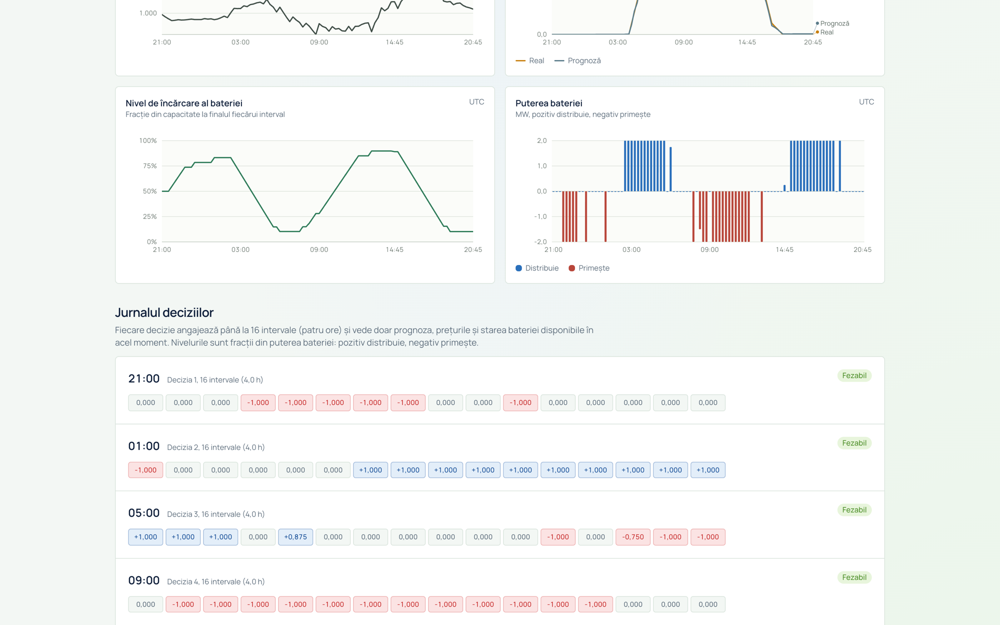<br><em>SOC and battery power, followed by the decision log: every 4-hour block shows its actions, rationale and feasibility.</em></td>
    <td width="50%">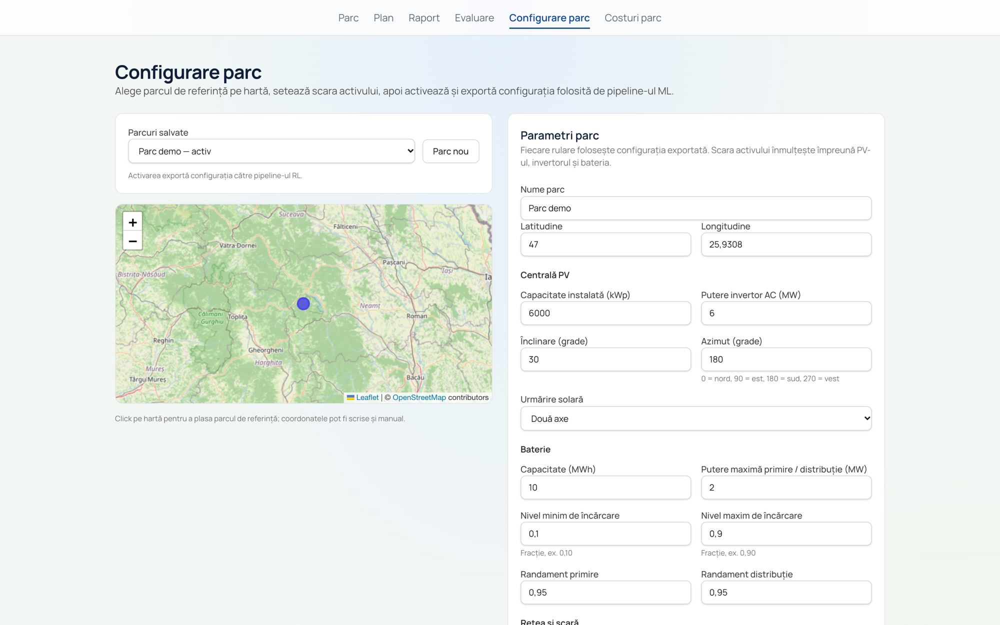<br><em>Farm configuration: Leaflet location picker, PV/battery parameters and the active farm exported to the battery pipeline.</em></td>
  </tr>
  <tr>
    <td colspan="2">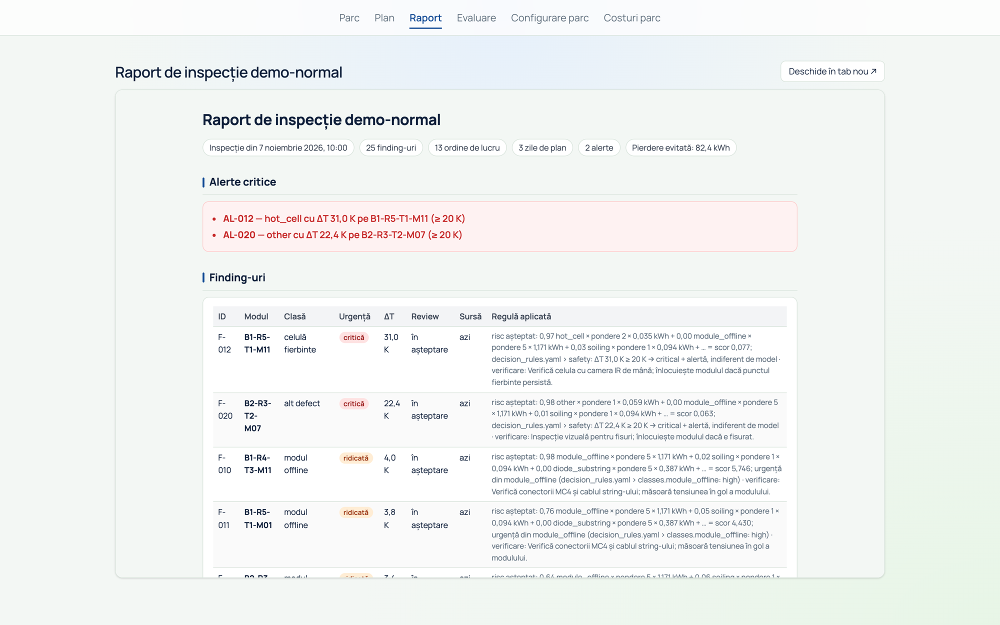<br><em>The server-rendered HTML inspection report, shown in the React report tab.</em></td>
  </tr>
</table>

</details>

## Tech stack

| Responsibility | Stack |
|---|---|
| **Interface** | React 19, TypeScript, Vite 8, react-router-dom 7, Zustand 5, Tailwind CSS 4, Recharts 3, Leaflet/react-leaflet 5, custom SVG charts, Playwright |
| **Application/API** | Python 3.14, FastAPI, Pydantic v2, pydantic-settings, SQLModel/SQLite, httpx, Jinja2, Pillow, numpy, ONNX Runtime, PyTorch CPU (Grad-CAM only), pytest, ruff |
| **Model training** | PyTorch + torchvision, scikit-learn, ONNX, Kaggle GPU notebooks, numpy/Pillow |
| **Battery/dispatch** | Python 3.11+, numpy, pandas, scikit-learn (HistGradientBoosting), SciPy (`linprog`/HiGHS), OpenAI SDK pointed at DeepSeek, PyYAML, matplotlib, pytest/ruff |
| **Ops** | uv, Docker, GitHub Actions, Railway / Hugging Face Spaces |

## Engineering decisions

| Decision | Why | Trade-off |
|---|---|---|
| **FastAPI is the single source of truth; React only renders** | One place for rules, ML and planning; testable without a browser | Every action needs the API; no offline mode |
| **Seeded digital twin from real held-out Raptor crops** | Repeatable demos with known ground truth, no drone required | Simulator bias; only test crops appear in frames |
| **QA and GPS registration before inference** | Invalid data must never read as “healthy” | Extra states and re-fly logic |
| **Two-pass consistency for glare** | Glare appears in one pass; defects appear in both | One extra frame per table |
| **Temperature scaling + per-class selective thresholds** | Probabilities are usable for decisions; 95% precision target | ~35% of crops still go to a human |
| **Expected-risk score, not argmax; ΔT ≥ 20 K safety override** | Uses the full probability vector; safety is independent of the classifier | Explanations are more complex; criticals need an explicit sort |
| **Automatic work orders + watch list + human override** | The agent acts without blocking; false positives are filtered | Tuning the watch threshold needs simulation |
| **Greedy, constraint-aware planner** | Explainable, fast, handles real crew constraints | Not globally optimal; 30-day horizon |
| **ONNX with in-graph preprocessing/TTA/bias; torch only for Grad-CAM** | One portable artifact; inference path stays light | 89 MB model; Grad-CAM needs PyTorch |
| **Fixed splits, test touched once, four baselines, degradation tests** | Credible ML claims; catches overfitting and fragility | Small dataset; 12→8 class mapping loses detail |
| **Separate battery venv + subprocess + JSON contracts** | Avoids dependency conflicts and isolates crashes | Serialization overhead; 600 s timeout |
| **Receding-horizon dispatch with validation and fallback** | Feasible, auditable schedules | LLM trails MPC by 3–4%; prompt/version drift |

## Run it

Three commands. No training is required: the model, calibration, thresholds, embeddings and
evaluation reports are committed.

```bash
# 1. Dataset (15.5 MB, SHA-256 verified) — crops are not committed
uv run --no-project python ml/fetch_raptor.py

# 2. Backend — http://localhost:8000, Swagger at /api/docs
cd backend && uv sync && uv run fastapi dev app/main.py

# 3. Frontend — http://localhost:5173
cd frontend && npm install && npm run dev
```

For the **Costuri parc** tab, install the battery package once:

```bash
cd RL && uv sync
```

Windows (PowerShell 5.1 does not support `&&`): after `cd backend; uv sync` and
`cd frontend; npm install`, run `powershell -ExecutionPolicy Bypass -File .\dev.ps1`.
`make setup` / `make dev` and `docker compose up --build` also work; Docker includes the
backend and frontend, not the battery package.

**Demo.** In the Parc tab, the three **Demo** buttons create fixed-seed missions:
`normal` (22), `bad_day` (11) and `explain` (19). Start the flight, run the data check, then
analyse. The normal flight takes about 40 seconds at speed 1; the other actions are seconds.
The `Costuri parc` tab runs the active farm with a strategy, split and day; MPC, rules, price
threshold and idle need no API key. The LLM strategy reads `DEEPSEEK_API_KEY` from `RL/.env`.

**Regenerate the evaluation numbers:**

```bash
uv run --project backend python evaluate.py
```

This writes `reports/eval.json` on the test split. The first run installs the `ml/` environment
(torch CPU, a few minutes).

**Regenerate the README screenshots:**

```bash
cd frontend
npx playwright install chromium   # first time only
CAPTURE=1 npx playwright test e2e/portfolio.spec.ts
```

## Tests and CI

```bash
(cd backend && uv run pytest -q && uv run ruff check .)
(cd frontend && npm run lint && npm run build && npm run e2e)
(cd ml && uv run pytest -q)
(cd RL && uv run pytest -q && uv run ruff check .)
```

First time, install the Playwright browser: `cd frontend && npx playwright install chromium`.

| Suite | Covers |
|---|---|
| **backend** | Simulator, pipeline steps, six robustness cases, decision rules, planner, carry-over, API contracts, Grad-CAM, similar cases, RL/PV reports, the 30 KB source-file rule |
| **ml** | Augmentation shapes, ONNX Runtime parity, TTA/bias, ensemble export, calibration/ECE/thresholds, embeddings, small CNN |
| **RL** | Config and data contracts (DST, issue time, aligned dataset), PV model, battery physics, strategies, MPC, LLM parsing/retries/fallback, runner |
| **frontend** | oxlint, TypeScript/Vite build, Playwright end-to-end on the three demo scenarios |

CI runs four jobs (backend, battery, ML, frontend). The backend job downloads the Raptor crops
first; the ML job installs CPU-only torch wheels to avoid the CUDA download.

## Known limitations

- **Demo-grade security and state.** No authentication, rate limiting or pagination; SQLite and
  in-memory SSE replay; one process. This is a hackathon demo, not a multi-tenant service.
- **PV actual is a proxy.** It is computed from archived Open-Meteo irradiance and the farm
  geometry, not a meter. The economics are energy-only merchant arbitrage: no network tariffs,
  taxes, imbalance costs or local demand.
- **Forecast causality.** The rest-of-day context can contain per-row forecasts issued after the
  decision time; a proper per-issue snapshot file exists (`pv_forecast_snapshots.csv`) but is not
  wired into the runner. The aerosol feature is also read at the target time, not the issue time.
- **Battery artifact drift.** The committed reports were produced with prompt **v2** and a farm
  configuration whose checksum differs from the current `farm.yaml`; the code ships prompt v3.
  Treat the battery numbers as artifact-reported, not as a frozen final protocol.
- **MPC and oracle LP coincide** under the evaluated setup (zero demand, no export limit), so
  the oracle is not a dispatch upper bound. The LLM gap is economic, not feasibility.
- **`RL/` is not reinforcement learning.** There is no policy training; the learned model is the
  supervised PV forecaster. The folder name is historical.
- **Romanian UI.** The target user is a Romanian O&M engineer; the README and captions are in
  English.

## Data and attribution

- **Raptor Maps InfraredSolarModules** — 20,000 thermal crops, MIT license, published at the
  ICLR 2020 workshop *AI for Earth Sciences*
  ([paper](https://ai4earthscience.github.io/iclr-2020-workshop/papers/ai4earth22.pdf)).
  `ml/fetch_raptor.py` downloads the official archive and verifies its SHA-256.
- **OPCOM PZU** — day-ahead 15-minute prices, scraped per delivery day.
- **ENTSO-E** — Romanian national load context.
- **Open-Meteo** — archived irradiance (PV-actual proxy), ECMWF IFS Single Runs and air quality.
- **DeepSeek** — the LLM dispatch agent, via an OpenAI-compatible API.
- No client data and no external training images beyond Raptor. No secrets are committed;
  secrets live only in `backend/.env` and `RL/.env` (gitignored).

## Team

Built by five contributors at Smarthack XI. See the
[contributors graph](https://github.com/jiri133/S-WAGG/graphs/contributors) for the full list.
The design rationale and domain vocabulary are in `docs/DESIGN_SPEC.md`, `docs/adr/` and
`GLOSSARY.md`. The original Romanian README is kept as [`README.ro.md`](README.ro.md).
