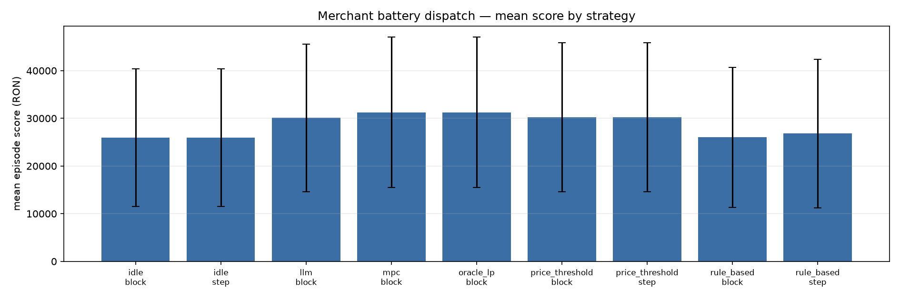

# Evaluation report — test

- Source CSV: `results.csv`
- Runs: **972**
- Days: **36**
- Skipped incomplete days: 2026-10-02
- Run metadata: `run_metadata.json`

Score is the full merchant objective: −cash flow − degradation − violations +
terminal value. Net cost is cash flow only (negative = revenue).

MPC and OracleLP have identical actions under the merchant balance: the dispatch
LP is price-only because prices are known D-1 and PV is a cash-flow constant.

## By strategy and mode

| Strategy | Mode | Runs | Days | Score mean | Score std | Net cost mean | Export rev mean | Throughput mean | Cycles mean | Self-cons mean |
|---|---|---|---|---|---|---|---|---|---|---|
| idle | block | 108 | 36 | 25,922.19 | 14,440.11 | -19,540.41 | 19,540.41 | 0.000 | 0.000 | 0.000 |
| idle | step | 108 | 36 | 25,922.19 | 14,440.11 | -19,540.41 | 19,540.41 | 0.000 | 0.000 | 0.000 |
| llm | block | 108 | 36 | 30,095.35 | 15,506.35 | -27,960.97 | 33,395.50 | 18.478 | 0.924 | 0.214 |
| mpc | block | 108 | 36 | 31,253.01 | 15,784.33 | -30,034.96 | 36,171.93 | 22.607 | 1.130 | 0.292 |
| oracle_lp | block | 108 | 36 | 31,253.01 | 15,784.33 | -30,034.96 | 36,171.93 | 22.607 | 1.130 | 0.292 |
| price_threshold | block | 108 | 36 | 30,220.82 | 15,616.20 | -28,591.09 | 34,499.72 | 18.977 | 0.949 | 0.182 |
| price_threshold | step | 108 | 36 | 30,220.82 | 15,616.20 | -28,591.09 | 34,499.72 | 18.977 | 0.949 | 0.182 |
| rule_based | block | 108 | 36 | 26,007.27 | 14,677.20 | -16,214.49 | 16,538.28 | 4.620 | 0.231 | 0.433 |
| rule_based | step | 108 | 36 | 26,807.25 | 15,537.30 | -26,216.15 | 26,216.15 | 14.765 | 0.738 | 0.454 |

## LLM telemetry

Mean per day per run. A 96-interval day has six decisions; a 100-interval DST
day has seven. Cost uses the provider rates recorded in `configs/agent.yaml`
(`pricing`). Feasibility is measured after validation; the invalid rate is
measured before fallback.

| Strategy | Mode | Runs | Feasible rate | Invalid rate | Tool calls/day | Tokens/day | Latency/day (s) | Cost/day (RON) |
|---|---|---|---|---|---|---|---|---|
| llm | block | 108 | 100.0% | 0.0% | 25.43 | 137,935 | 90.3 | 0.0690 |

## LLM vs reference strategies

Block mode; score is the full merchant objective (higher is better). The gap
is relative to the reference. `rule_based` here is block mode; its step-mode
score is in the main table.

| Reference | LLM score | Reference score | Gap |
|---|---|---|---|
| idle | 30,095.35 | 25,922.19 | +16.1% |
| rule_based | 30,095.35 | 26,007.27 | +15.7% |
| price_threshold | 30,095.35 | 30,220.82 | -0.4% |
| mpc | 30,095.35 | 31,253.01 | -3.7% |
| oracle_lp | 30,095.35 | 31,253.01 | -3.7% |

## By regime

| Regime | Strategy | Mode | Runs | Score mean | Net cost mean | Export rev mean | Throughput mean | Self-cons mean |
|---|---|---|---|---|---|---|---|---|
| all | idle | block | 108 | 25,922.19 | -19,540.41 | 19,540.41 | 0.000 | 0.000 |
| all | idle | step | 108 | 25,922.19 | -19,540.41 | 19,540.41 | 0.000 | 0.000 |
| all | llm | block | 108 | 30,095.35 | -27,960.97 | 33,395.50 | 18.478 | 0.214 |
| all | mpc | block | 108 | 31,253.01 | -30,034.96 | 36,171.93 | 22.607 | 0.292 |
| all | oracle_lp | block | 108 | 31,253.01 | -30,034.96 | 36,171.93 | 22.607 | 0.292 |
| all | price_threshold | block | 108 | 30,220.82 | -28,591.09 | 34,499.72 | 18.977 | 0.182 |
| all | price_threshold | step | 108 | 30,220.82 | -28,591.09 | 34,499.72 | 18.977 | 0.182 |
| all | rule_based | block | 108 | 26,007.27 | -16,214.49 | 16,538.28 | 4.620 | 0.433 |
| all | rule_based | step | 108 | 26,807.25 | -26,216.15 | 26,216.15 | 14.765 | 0.454 |
| high_price | idle | block | 36 | 23,604.82 | -15,948.17 | 15,948.17 | 0.000 | 0.000 |
| high_price | idle | step | 36 | 23,604.82 | -15,948.17 | 15,948.17 | 0.000 | 0.000 |
| high_price | llm | block | 36 | 27,126.30 | -23,133.91 | 31,918.26 | 17.068 | 0.142 |
| high_price | mpc | block | 36 | 28,190.64 | -24,930.80 | 34,452.88 | 21.547 | 0.259 |
| high_price | oracle_lp | block | 36 | 28,190.64 | -24,930.80 | 34,452.88 | 21.547 | 0.259 |
| high_price | price_threshold | block | 36 | 27,087.81 | -23,777.92 | 32,100.58 | 16.347 | 0.090 |
| high_price | price_threshold | step | 36 | 27,087.81 | -23,777.92 | 32,100.58 | 16.347 | 0.090 |
| high_price | rule_based | block | 36 | 23,317.06 | -11,708.85 | 12,109.70 | 3.679 | 0.587 |
| high_price | rule_based | step | 36 | 23,247.89 | -22,242.22 | 22,242.22 | 11.776 | 0.523 |
| low_price | idle | block | 36 | 33,769.13 | -28,633.75 | 28,633.75 | 0.000 | 0.000 |
| low_price | idle | step | 36 | 33,769.13 | -28,633.75 | 28,633.75 | 0.000 | 0.000 |
| low_price | llm | block | 36 | 39,747.22 | -38,788.40 | 40,420.42 | 19.578 | 0.216 |
| low_price | mpc | block | 36 | 41,059.43 | -41,135.30 | 43,930.06 | 24.407 | 0.250 |
| low_price | oracle_lp | block | 36 | 41,059.43 | -41,135.30 | 43,930.06 | 24.407 | 0.250 |
| low_price | price_threshold | block | 36 | 40,032.59 | -39,840.02 | 41,710.41 | 20.632 | 0.216 |
| low_price | price_threshold | step | 36 | 40,032.59 | -39,840.02 | 41,710.41 | 20.632 | 0.216 |
| low_price | rule_based | block | 36 | 34,396.48 | -26,779.91 | 26,888.34 | 6.133 | 0.165 |
| low_price | rule_based | step | 36 | 36,419.40 | -36,303.96 | 36,303.96 | 18.996 | 0.266 |
| volatile | idle | block | 36 | 29,495.80 | -23,545.06 | 23,545.06 | 0.000 | 0.000 |
| volatile | idle | step | 36 | 29,495.80 | -23,545.06 | 23,545.06 | 0.000 | 0.000 |
| volatile | llm | block | 36 | 36,305.26 | -34,745.78 | 38,561.71 | 19.764 | 0.207 |
| volatile | mpc | block | 36 | 37,687.03 | -36,526.24 | 41,553.70 | 23.844 | 0.256 |
| volatile | oracle_lp | block | 36 | 37,687.03 | -36,526.24 | 41,553.70 | 23.844 | 0.256 |
| volatile | price_threshold | block | 36 | 36,240.67 | -34,989.14 | 38,457.54 | 18.668 | 0.149 |
| volatile | price_threshold | step | 36 | 36,240.67 | -34,989.14 | 38,457.54 | 18.668 | 0.149 |
| volatile | rule_based | block | 36 | 30,042.54 | -21,608.00 | 21,786.40 | 5.640 | 0.285 |
| volatile | rule_based | step | 36 | 31,761.21 | -31,362.90 | 31,362.90 | 16.749 | 0.340 |
| sunny | idle | block | 36 | 39,280.56 | -33,765.88 | 33,765.88 | 0.000 | 0.000 |
| sunny | idle | step | 36 | 39,280.56 | -33,765.88 | 33,765.88 | 0.000 | 0.000 |
| sunny | llm | block | 36 | 45,336.12 | -44,100.91 | 45,524.23 | 18.497 | 0.174 |
| sunny | mpc | block | 36 | 46,808.86 | -46,514.27 | 49,110.42 | 23.889 | 0.214 |
| sunny | oracle_lp | block | 36 | 46,808.86 | -46,514.27 | 49,110.42 | 23.889 | 0.214 |
| sunny | price_threshold | block | 36 | 45,541.56 | -44,981.62 | 46,940.10 | 19.082 | 0.160 |
| sunny | price_threshold | step | 36 | 45,541.56 | -44,981.62 | 46,940.10 | 19.082 | 0.160 |
| sunny | rule_based | block | 36 | 39,754.41 | -31,214.65 | 31,281.50 | 6.081 | 0.121 |
| sunny | rule_based | step | 36 | 42,059.92 | -41,894.65 | 41,894.65 | 19.657 | 0.217 |
| cloudy | idle | block | 36 | 11,357.56 | -4,277.22 | 4,277.22 | 0.000 | 0.000 |
| cloudy | idle | step | 36 | 11,357.56 | -4,277.22 | 4,277.22 | 0.000 | 0.000 |
| cloudy | llm | block | 36 | 14,379.49 | -11,349.02 | 19,609.85 | 16.529 | 0.207 |
| cloudy | mpc | block | 36 | 15,259.92 | -12,956.25 | 22,640.63 | 20.146 | 0.307 |
| cloudy | oracle_lp | block | 36 | 15,259.92 | -12,956.25 | 22,640.63 | 20.146 | 0.307 |
| cloudy | price_threshold | block | 36 | 14,293.74 | -11,728.76 | 20,814.75 | 17.897 | 0.184 |
| cloudy | price_threshold | step | 36 | 14,293.74 | -11,728.76 | 20,814.75 | 17.897 | 0.184 |
| cloudy | rule_based | block | 36 | 11,003.69 | -1,142.02 | 1,730.53 | 3.436 | 0.819 |
| cloudy | rule_based | step | 36 | 10,735.00 | -9,632.61 | 9,632.61 | 7.547 | 0.612 |
| weekend | idle | block | 30 | 23,347.93 | -17,661.48 | 17,661.48 | 0.000 | 0.000 |
| weekend | idle | step | 30 | 23,347.93 | -17,661.48 | 17,661.48 | 0.000 | 0.000 |
| weekend | llm | block | 30 | 27,825.74 | -26,577.91 | 29,665.47 | 17.460 | 0.212 |
| weekend | mpc | block | 30 | 28,751.35 | -28,325.63 | 31,831.51 | 20.149 | 0.272 |
| weekend | oracle_lp | block | 30 | 28,751.35 | -28,325.63 | 31,831.51 | 20.149 | 0.272 |
| weekend | price_threshold | block | 30 | 27,465.53 | -26,477.63 | 30,153.42 | 17.062 | 0.165 |
| weekend | price_threshold | step | 30 | 27,465.53 | -26,477.63 | 30,153.42 | 17.062 | 0.165 |
| weekend | rule_based | block | 30 | 24,139.28 | -16,000.44 | 16,184.43 | 5.727 | 0.398 |
| weekend | rule_based | step | 30 | 25,614.63 | -25,198.52 | 25,198.52 | 15.327 | 0.417 |

## Plots

