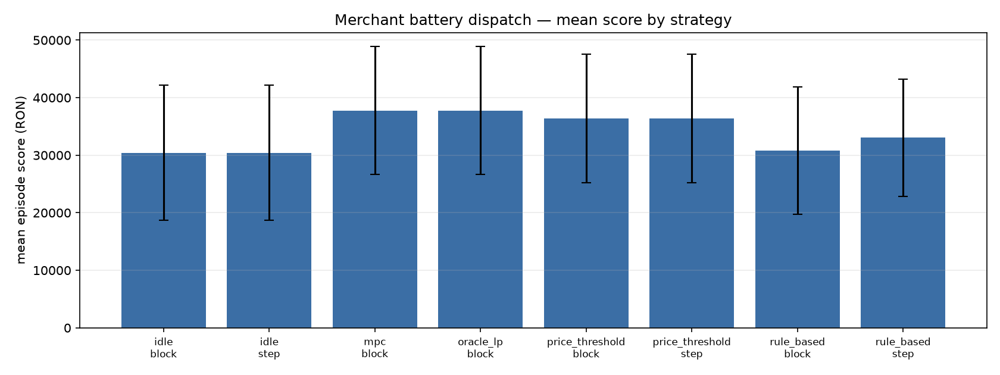
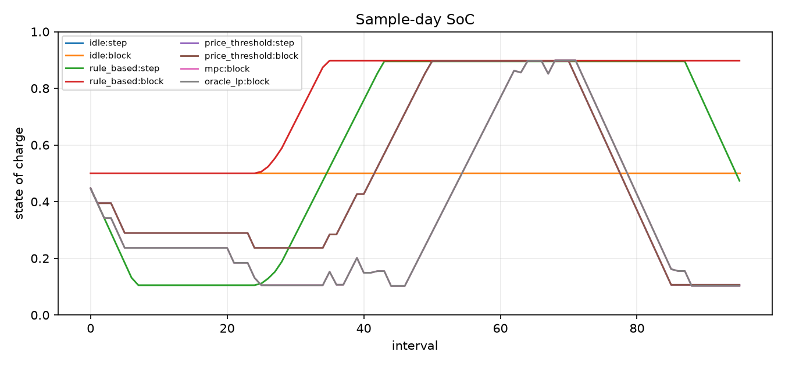
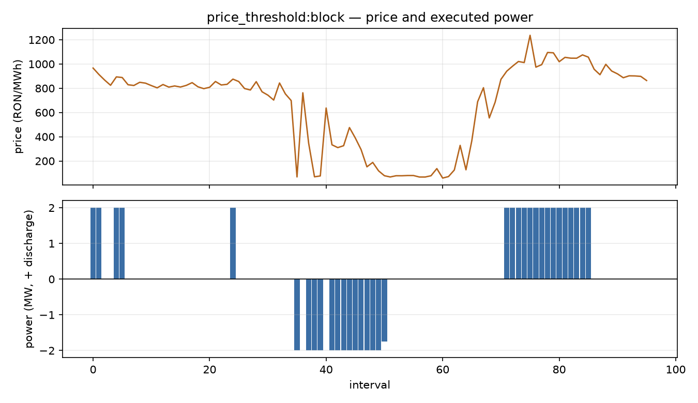

# Evaluation report — val

## Scope

- Split: **val**
- Farm: **seed-demo** (`s=1`, checksum `2fb404feebe8…`)
- Repeats per day: **3**
- Days: **61**
- Runs: **1464**
- Per-day CSV: `results.csv`

Score is the full merchant objective: −cash flow − degradation − violations +
terminal value. Net cost is cash flow only (negative = revenue).

MPC and OracleLP have identical actions here: with known D-1 prices, zero site
demand and no export limit, the dispatch LP is price-only. The oracle differs
only in using actual future PV for the reported objective; it is the upper bound.

## By strategy and mode

| Strategy | Mode | Runs | Days | Score mean | Score std | Net cost mean | Export rev mean | Throughput mean | Cycles mean | Self-cons mean |
|---|---|---|---|---|---|---|---|---|---|---|
| idle | block | 183 | 61 | 30,421.08 | 11,755.32 | -26,340.68 | 26,340.68 | 0.000 | 0.000 | 0.000 |
| idle | step | 183 | 61 | 30,421.08 | 11,755.32 | -26,340.68 | 26,340.68 | 0.000 | 0.000 | 0.000 |
| mpc | block | 183 | 61 | 37,759.69 | 11,134.09 | -38,075.80 | 39,094.22 | 23.106 | 1.155 | 0.227 |
| oracle_lp | block | 183 | 61 | 37,759.69 | 11,134.09 | -38,075.80 | 39,094.22 | 23.106 | 1.155 | 0.227 |
| price_threshold | block | 183 | 61 | 36,383.25 | 11,173.02 | -36,409.55 | 36,936.61 | 17.938 | 0.897 | 0.170 |
| price_threshold | step | 183 | 61 | 36,383.25 | 11,173.02 | -36,409.55 | 36,936.61 | 17.938 | 0.897 | 0.170 |
| rule_based | block | 183 | 61 | 30,803.22 | 11,021.28 | -24,186.81 | 24,334.93 | 6.513 | 0.326 | 0.134 |
| rule_based | step | 183 | 61 | 33,055.43 | 10,183.82 | -31,396.40 | 31,396.40 | 17.547 | 0.877 | 0.221 |

## By regime

Regimes are split terciles: high/low mean price, high price volatility, high/low
daily PV energy, plus weekends. A day can be in several regimes; `all` is the
full split.

| Regime | Strategy | Mode | Runs | Score mean | Net cost mean | Export rev mean | Throughput mean | Self-cons mean |
|---|---|---|---|---|---|---|---|---|
| all | idle | block | 183 | 30,421.08 | -26,340.68 | 26,340.68 | 0.000 | 0.000 |
| all | idle | step | 183 | 30,421.08 | -26,340.68 | 26,340.68 | 0.000 | 0.000 |
| all | mpc | block | 183 | 37,759.69 | -38,075.80 | 39,094.22 | 23.106 | 0.227 |
| all | oracle_lp | block | 183 | 37,759.69 | -38,075.80 | 39,094.22 | 23.106 | 0.227 |
| all | price_threshold | block | 183 | 36,383.25 | -36,409.55 | 36,936.61 | 17.938 | 0.170 |
| all | price_threshold | step | 183 | 36,383.25 | -36,409.55 | 36,936.61 | 17.938 | 0.170 |
| all | rule_based | block | 183 | 30,803.22 | -24,186.81 | 24,334.93 | 6.513 | 0.134 |
| all | rule_based | step | 183 | 33,055.43 | -31,396.40 | 31,396.40 | 17.547 | 0.221 |
| high_price | idle | block | 63 | 36,824.28 | -31,957.96 | 31,957.96 | 0.000 | 0.000 |
| high_price | idle | step | 63 | 36,824.28 | -31,957.96 | 31,957.96 | 0.000 | 0.000 |
| high_price | mpc | block | 63 | 44,733.96 | -44,936.71 | 46,647.42 | 24.041 | 0.244 |
| high_price | oracle_lp | block | 63 | 44,733.96 | -44,936.71 | 46,647.42 | 24.041 | 0.244 |
| high_price | price_threshold | block | 63 | 43,257.92 | -43,103.16 | 44,125.27 | 18.002 | 0.175 |
| high_price | price_threshold | step | 63 | 43,257.92 | -43,103.16 | 44,125.27 | 18.002 | 0.175 |
| high_price | rule_based | block | 63 | 36,777.58 | -28,754.61 | 29,086.38 | 5.561 | 0.127 |
| high_price | rule_based | step | 63 | 38,793.71 | -37,043.78 | 37,043.78 | 17.942 | 0.245 |
| low_price | idle | block | 63 | 20,795.47 | -17,563.86 | 17,563.86 | 0.000 | 0.000 |
| low_price | idle | step | 63 | 20,795.47 | -17,563.86 | 17,563.86 | 0.000 | 0.000 |
| low_price | mpc | block | 63 | 29,019.08 | -29,478.15 | 29,735.80 | 22.442 | 0.212 |
| low_price | oracle_lp | block | 63 | 29,019.08 | -29,478.15 | 29,735.80 | 22.442 | 0.212 |
| low_price | price_threshold | block | 63 | 27,551.54 | -27,757.81 | 27,784.43 | 17.759 | 0.167 |
| low_price | price_threshold | step | 63 | 27,551.54 | -27,757.81 | 27,784.43 | 17.759 | 0.167 |
| low_price | rule_based | block | 63 | 21,761.95 | -16,421.62 | 16,437.62 | 6.237 | 0.127 |
| low_price | rule_based | step | 63 | 24,881.97 | -23,524.62 | 23,524.62 | 17.266 | 0.193 |
| volatile | idle | block | 63 | 27,309.06 | -23,300.39 | 23,300.39 | 0.000 | 0.000 |
| volatile | idle | step | 63 | 27,309.06 | -23,300.39 | 23,300.39 | 0.000 | 0.000 |
| volatile | mpc | block | 63 | 36,961.14 | -37,290.51 | 38,193.82 | 23.025 | 0.215 |
| volatile | oracle_lp | block | 63 | 36,961.14 | -37,290.51 | 38,193.82 | 23.025 | 0.215 |
| volatile | price_threshold | block | 63 | 35,704.13 | -35,779.19 | 36,070.29 | 18.490 | 0.173 |
| volatile | price_threshold | step | 63 | 35,704.13 | -35,779.19 | 36,070.29 | 18.490 | 0.173 |
| volatile | rule_based | block | 63 | 28,522.94 | -22,207.41 | 22,322.45 | 6.598 | 0.126 |
| volatile | rule_based | step | 63 | 31,416.08 | -29,917.85 | 29,917.85 | 17.753 | 0.208 |
| sunny | idle | block | 63 | 37,202.04 | -33,335.18 | 33,335.18 | 0.000 | 0.000 |
| sunny | idle | step | 63 | 37,202.04 | -33,335.18 | 33,335.18 | 0.000 | 0.000 |
| sunny | mpc | block | 63 | 44,651.96 | -45,017.64 | 45,736.59 | 23.200 | 0.172 |
| sunny | oracle_lp | block | 63 | 44,651.96 | -45,017.64 | 45,736.59 | 23.200 | 0.172 |
| sunny | price_threshold | block | 63 | 43,073.26 | -43,125.11 | 43,373.03 | 17.326 | 0.125 |
| sunny | price_threshold | step | 63 | 43,073.26 | -43,125.11 | 43,373.03 | 17.326 | 0.125 |
| sunny | rule_based | block | 63 | 36,896.35 | -30,255.82 | 30,262.04 | 5.339 | 0.090 |
| sunny | rule_based | step | 63 | 39,043.04 | -36,734.94 | 36,734.94 | 16.628 | 0.154 |
| cloudy | idle | block | 63 | 24,639.47 | -20,129.76 | 20,129.76 | 0.000 | 0.000 |
| cloudy | idle | step | 63 | 24,639.47 | -20,129.76 | 20,129.76 | 0.000 | 0.000 |
| cloudy | mpc | block | 63 | 32,345.22 | -32,567.03 | 33,951.39 | 22.977 | 0.303 |
| cloudy | oracle_lp | block | 63 | 32,345.22 | -32,567.03 | 33,951.39 | 22.977 | 0.303 |
| cloudy | price_threshold | block | 63 | 31,027.03 | -30,970.70 | 31,943.19 | 18.439 | 0.223 |
| cloudy | price_threshold | step | 63 | 31,027.03 | -30,970.70 | 31,943.19 | 18.439 | 0.223 |
| cloudy | rule_based | block | 63 | 25,660.09 | -18,255.71 | 18,611.39 | 6.377 | 0.182 |
| cloudy | rule_based | step | 63 | 27,956.27 | -26,819.72 | 26,819.72 | 18.379 | 0.317 |
| weekend | idle | block | 54 | 18,500.76 | -15,286.71 | 15,286.71 | 0.000 | 0.000 |
| weekend | idle | step | 54 | 18,500.76 | -15,286.71 | 15,286.71 | 0.000 | 0.000 |
| weekend | mpc | block | 54 | 26,624.99 | -27,062.79 | 27,227.58 | 21.994 | 0.233 |
| weekend | oracle_lp | block | 54 | 26,624.99 | -27,062.79 | 27,227.58 | 21.994 | 0.233 |
| weekend | price_threshold | block | 54 | 25,071.81 | -25,270.61 | 25,397.57 | 17.578 | 0.173 |
| weekend | price_threshold | step | 54 | 25,071.81 | -25,270.61 | 25,397.57 | 17.578 | 0.173 |
| weekend | rule_based | block | 54 | 19,625.28 | -14,355.50 | 14,380.17 | 6.028 | 0.139 |
| weekend | rule_based | step | 54 | 22,983.27 | -21,742.14 | 21,742.14 | 17.383 | 0.222 |

## Plots

